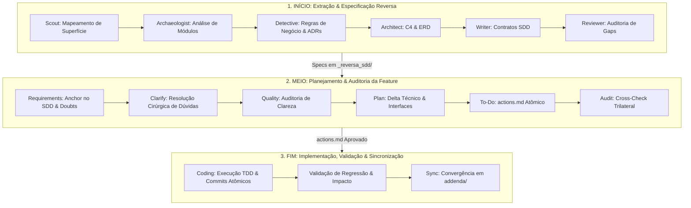

# AGENTS.md — Protocolo Operacional para Agentes Autônomos com Reversa & Token Economy

> Este documento estabelece o protocolo de ciclo de vida completo (**Início, Meio e Fim**) para agentes de codificação e engenharia de software autônomos. Ele integra o framework **[Reversa](https://github.com/sandeco/reversa)** para transformar sistemas legados ou requisitos greenfield em especificações executáveis (SDD — *Spec-Driven Development*) até a implementação de código com testes, além de aplicar as **Skills Globais de Redução e Otimização de Tokens**.

---

## 🧭 Visão Geral do Ciclo de Vida do Agente



---

## ⚡ Regras de Ouro & Governança

1. **Imutabilidade do Legado (Não-Destrutivo):**
   - Durante as fases de análise e especificação, os agentes **NUNCA** modificam ou removem código existente.
   - Escrita estritamente restrita a `.reversa/`, `_reversa_sdd/` e `_reversa_forward/`.
2. **Desenvolvimento Orientado a Especificação (SDD):**
   - Nenhuma linha de código de produção é alterada ou implementada sem um `actions.md` auditado e aprovado.
3. **Pausas Human-in-the-Loop:**
   - Entre fases críticas, o agente orquestrador deve apresentar o sumário das descobertas e aguardar a confirmação explícita (`CONTINUAR`) do operador.

---

## 1. INÍCIO: Extração & Especificações Executáveis (Reversa Discovery)

O objetivo da fase inicial é extrair o conhecimento implícito, contratos, modelos de dados e regras de negócio para a pasta `_reversa_sdd/` sem alucinações.

### 1.1 Inicialização
- **Comando de Entrada:** `/reversa` (ou `reversa` em ambientes sem slash commands).
- **Projetos Novos (Greenfield):** `/reversa-new` para ideação até o SDD.
- **Estrutura de Estado:** Criada em `.reversa/state.json` e `.reversa/config.toml`.

### 1.2 Pipeline de Agentes de Descoberta

| Agente | Papel | Artefatos Gerados |
| :--- | :--- | :--- |
| **Reversa (Orquestrador)** | Coordenador central. Controla fases, estados e checkpoints. | `.reversa/state.json`, `.reversa/plan.md` |
| **Scout** | Mapeamento de superfície: diretórios, linguagens, frameworks, entrypoints e dependências. | `.reversa/context/surface.json` |
| **Archaeologist** | Escavação profunda módulo a módulo: algoritmos, fluxo de controle e estruturas de dados. | `_reversa_sdd/code-analysis/` |
| **Detective** | Mineração de regras de negócio implícitas, ADRs retroativos, permissões e fluxos de estado. | `_reversa_sdd/domain/` |
| **Architect** | Síntese de arquitetura: diagramas C4 (Contexto, Containers, Componentes), ERD e débito técnico. | `_reversa_sdd/architecture/` |
| **Writer** | Redação das especificações SDD como contratos operacionais executáveis com rastreabilidade. | `_reversa_sdd/specs/` |
| **Reviewer** | Inspeção cruzada, identificação de inconsistências e preenchimento de lacunas. | `_reversa_sdd/reviews/` |

### 1.3 Especialistas Auxiliares (On-Demand)
- **Data Master:** Análise profunda de DDL, ORM, triggers, procedures e integridade relacional.
- **Design System:** Extração de tokens de design, CSS/layouts e componentes visuais.
- **Soul Extractor:** Consolidação de uma especificação executiva concisa (`soul.md`) com o propósito fundacional do sistema.

---

## 2. MEIO: Planejamento, Refinamento & Auditoria (Reversa Forward)

Quando uma nova funcionalidade, alteração ou refatoração for solicitada, o ciclo **Forward** é disparado. Ele ancora as decisões nas especificações geradas no Início.

### 2.1 Inicialização
- **Comando de Entrada:** `/reversa-forward` (ou `/reversa-forward-autonomous` para filas de features).
- **Local de Trabalho:** `_reversa_forward/<feature-id>/`.

### 2.2 Estágios Sequenciais de Refinamento

1. **Requirements (`reversa-requirements`):**
   - Converte o pedido do usuário em `requirements.md`.
   - Ancoragem obrigatória nos artefatos de `_reversa_sdd/`.
   - Marca lacunas ou dúvidas não resolvidas com tags `[DOUBT]`.
2. **Clarify (`reversa-clarify`):**
   - Resolve os marcadores `[DOUBT]` através de uma entrevista cirúrgica (máximo 5 perguntas objetivas).
3. **Quality (`reversa-quality`):**
   - Auditoria somente leitura dos requisitos textuais, gerando `requirements-audit.md`.
4. **Plan (`reversa-plan`):**
   - Define a estratégia técnica de implementação como um *delta* sobre o legado.
   - Gera: `roadmap.md`, `investigation.md`, `data-delta.md` e pastas de contratos em `interfaces/`.
5. **To-Do (`reversa-to-do`):**
   - Converte o roadmap em uma lista estrita de tarefas atômicas: `actions.md`.
   - Cada tarefa deve conter: ID único estável, critério de aceite, dependências e flags de paralelismo.
6. **Audit (`reversa-audit`):**
   - Verificação cruzada trilateral (`cross-check.md`) entre Requisitos ↔ Roadmap ↔ Actions.
   - Garante que nenhuma ação fique sem requisito e nenhum requisito fique sem ação.

---

## 3. FIM: Implementação, Testes, Verificação & Sincronização

A etapa final transforma os planos auditados em código executável, validado por testes e sincronizado com a base de conhecimento.

### 3.1 Implementação Controlada (`reversa-coding`)
- **Execução por Ações:** O agente lê `actions.md` e executa tarefa a tarefa, marcando checkboxes (`[x]`).
- **Segurança de Escrita:** Edita código-fonte estritamente nos diretórios autorizados por `.reversa/reversa-config.json`.
- **Rastreabilidade e Logs em Disco:**
  - `progress.jsonl`: Linha do tempo dos passos executados.
  - `legacy-impact.md`: Relatório de impacto no comportamento preexistente.
  - `regression-watch.md`: Lista de pontos de atenção e testes de regressão executados.
- **Garantia de Qualidade:** Execução mandatória de testes automatizados unitários/integrados e linting antes de finalizar.

### 3.2 Convergência & Atualização de Especificações (`reversa-sync`)
- Toda feature finalizada **deve convergir** de volta para o SDD global.
- O agente gera um adendo incremental em `_reversa_sdd/addenda/`.
- **Economia e Integridade:** Evita ter que rodar uma re-extração reversa completa (`/reversa`) a cada entrega, mantendo o histórico de contratos sempre fiel ao código real.

### 3.3 Tratamento de Defeitos com Rastreabilidade (`reversa-debugger`)
- Em caso de bugs pós-implementação, use `/reversa-debugger` e `/reversa-debugger-fix`.
- Os bugs são mapeados contra as especificações em `_reversa_sdd/` para encontrar a causa raiz e evitar regressões.

---

## 🧠 Skills Globais de Redução e Otimização de Tokens (Token Economy)

Para garantir máxima eficiência operacional, evitar estouro de contexto e reduzir custos de API, todos os agentes devem obedecer rigorosamente às diretrizes de otimização de tokens extraídas do ambiente global de skills:

### 1. Progressive Disclosure (Divulgação Progressiva de Habilidades & Contexto)
- **Regra:** Nunca injete o conteúdo integral de regras, documentações ou skills no prompt de início.
- **Aplicação:** Carregue apenas índices, assinaturas e nomes. Acesse o corpo do `SKILL.md` ou arquivo de especificação exclusivamente sob demanda (`just-in-time`) quando o agente for ativado.

### 2. Compactação de Contexto e Thresholds (`CompactionConfig`)
- **Regra:** Em conversas longas ou multi-turnos, configure thresholds de compactação.
- **Configuração de Referência:**
  ```python
  from google.antigravity import LocalAgentConfig, types

  config = LocalAgentConfig(
      compaction_config=types.CompactionConfig(
          token_threshold=50_000  # Evita o histórico antigo além do limiar, substituindo por sumário
      )
  )
  ```
- **Prática:** Turnos antigos são resumidos cumulativamente no histórico; apenas o passo atual e as instruções ativas permanecem com fidelidade integral.

### 3. Controle Proativo de Orçamento de Sessão (`BudgetConfig`)
- **Regra:** Imponha travas rígidas para prevenir loops infinitos de raciocínio (*reasoning cascades*) e chamadas repetitivas de ferramentas.
- **Limites Operacionais:**
  ```python
  budget_config = types.BudgetConfig(
      max_model_calls=15,          # Teto de chamadas ao LLM por sub-tarefa
      max_tool_calls=30,           # Limite de execuções de ferramentas
      max_input_tokens=120_000,    # Limite líquido de tokens de entrada (descontando cache)
      max_output_tokens=25_000,    # Limite acumulado de tokens de saída
      max_total_tokens=140_000     # Limite global da sessão
  )
  ```

### 4. Leitura Cirúrgica e Paginada de Arquivos
- **Proibição:** É estritamente proibido ler arquivos inteiros de código fonte com mais de 200 linhas sem delimitação.
- **Comportamento Padrão:**
  - Utilize ferramentas de busca rápida (`grep`, `Select-String`, busca de símbolos) para localizar a linha de interesse.
  - Utilize sempre parâmetros de fatiamento (`StartLine`, `EndLine`, `limit`) trazendo apenas o escopo necessário para a análise ou edição contígua.

### 5. Isolamento de Contexto via Subagentes Dedicados (`research` / `self`)
- **Regra:** Não sobrecarregue o contexto do agente orquestrador com saídas extensas de logs, compilações ou buscas exploratórias de código.
- **Delegação:** Use subagentes isolados para executar varreduras em repositórios e devolver apenas o sumário final sintetizado ao agente principal.

### 6. Persistência de Estado Fora do Contexto (Artifact-Driven State)
- **Regra:** Nunca confie no histórico de chat para manter o estado de tarefas longas.
- **Prática:** O progresso deve ser persistido em disco (`.reversa/state.json`, `.reversa/plan.md`, `progress.jsonl`). O agente lê o arquivo de estado em vez de re-analisar 50 mensagens anteriores.

---

## 🛠️ Novas Skills Globais Implementadas (Machine-Local)

As seguintes skills avançadas de engenharia de software foram implementadas em `~/.gemini/config/skills/` e estão disponíveis para invocação imediata:

1. **[`ast-context-distiller`](file:///C:/Users/vicenzo.mori/.gemini/config/skills/ast-context-distiller/SKILL.md):**
   - *Finalidade:* Poda de corpos de funções via AST para extrair apenas assinaturas e tipos, economizando até 90% de tokens em inspeções de dependências.
   - *Script Auxiliar:* `scripts/distill_ast.py`.
2. **[`agent-blast-radius-sentinel`](file:///C:/Users/vicenzo.mori/.gemini/config/skills/agent-blast-radius-sentinel/SKILL.md):**
   - *Finalidade:* Análise preventiva de impacto em cascata, calculando todos os pontos de chamada e módulos afetados antes de refatorações ou edições estruturais.
   - *Script Auxiliar:* `scripts/calc_blast_radius.py`.
3. **[`mutation-test-critic`](file:///C:/Users/vicenzo.mori/.gemini/config/skills/mutation-test-critic/SKILL.md):**
   - *Finalidade:* Eliminação do "teatro de testes" injetando mutantes no código para auditar se a suíte de testes realmente captura falhas lógicas e de fronteira.
   - *Referência:* `references/mutation_strategies.md`.
4. **[`supply-chain-typosquatting-auditor`](file:///C:/Users/vicenzo.mori/.gemini/config/skills/supply-chain-typosquatting-auditor/SKILL.md):**
   - *Finalidade:* Auditoria prévia de pacotes para evitar alucinações de bibliotecas inexistentes e ataques de typosquatting em `pip install` e `npm install`.
   - *Script Auxiliar:* `scripts/audit_package.py`.
5. **[`adversarial-devils-advocate`](file:///C:/Users/vicenzo.mori/.gemini/config/skills/adversarial-devils-advocate/SKILL.md):**
   - *Finalidade:* Crítico adversário para a fase de planejamento, identificando *race conditions*, memory leaks, falhas de timeout e brechas de segurança antes de codificar.
   - *Referência:* `references/adversarial_checklist.md`.

---

## 📋 Resumo das Fases Operacionais

```
┌─────────────────────────────────────────────────────────────────────────────┐
│ 1. INÍCIO (Discovery)                                                       │
│    /reversa ──► Scout ──► Archaeologist ──► Detective ──► Architect ──►     │
│    Writer ──► Reviewer ──► Especificações SDD salvas em _reversa_sdd/       │
├─────────────────────────────────────────────────────────────────────────────┤
│ 2. MEIO (Forward Planning)                                                  │
│    /reversa-forward ──► Requirements ──► Clarify ──► Quality ──► Plan ──►    │
│    To-Do (actions.md) ──► Audit (cross-check.md)                            │
├─────────────────────────────────────────────────────────────────────────────┤
│ 3. FIM (Implementation & Convergence)                                      │
│    Coding (actions.md) ──► Testes & Regressão ──► Sync (_reversa_sdd/addenda)│
└─────────────────────────────────────────────────────────────────────────────┘
```
